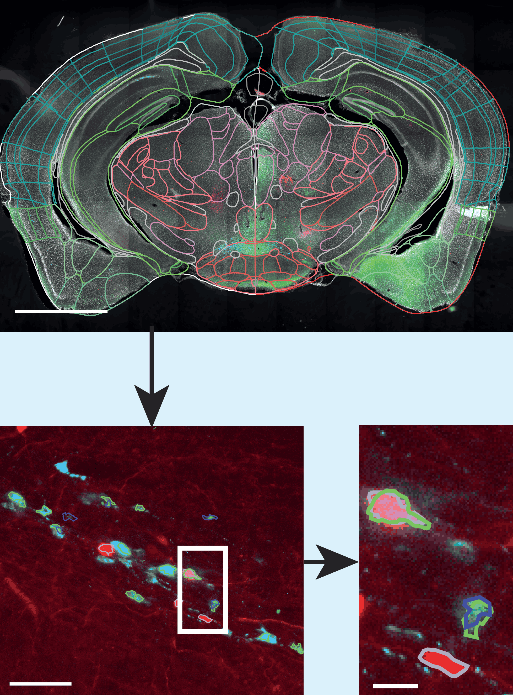
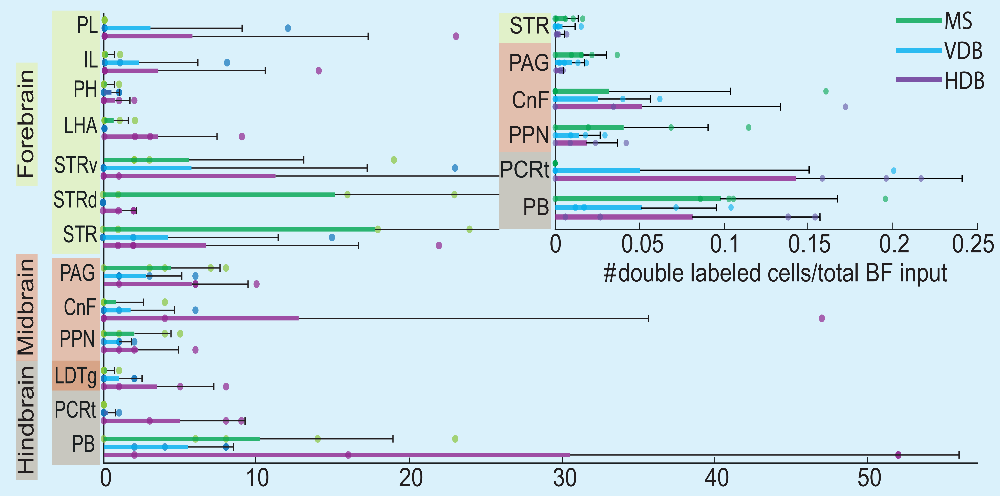
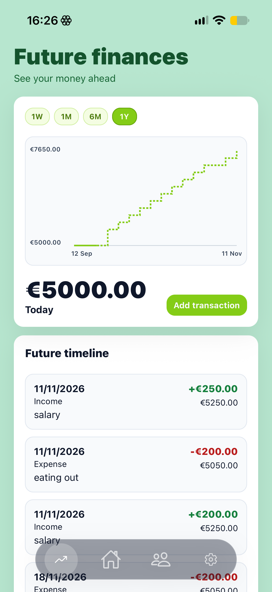
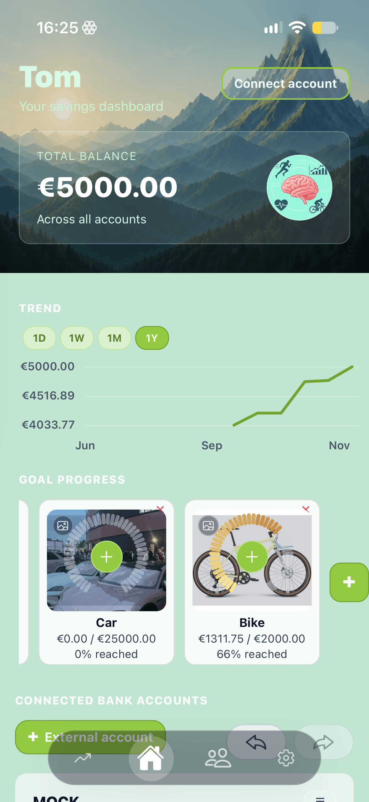
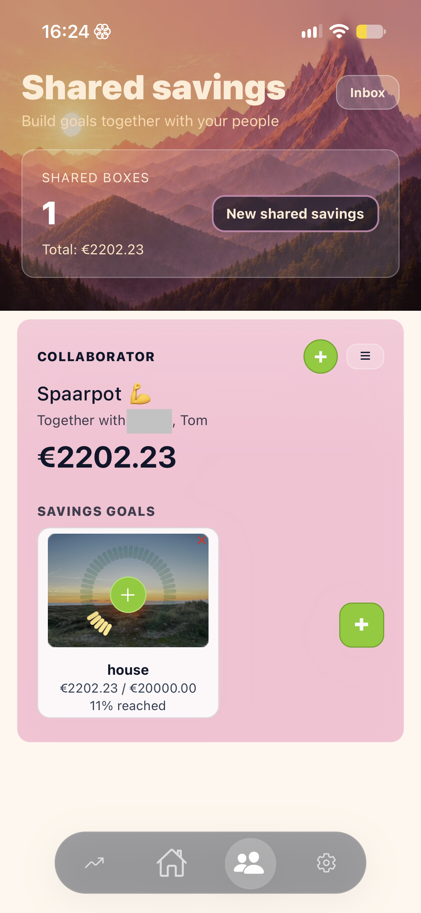
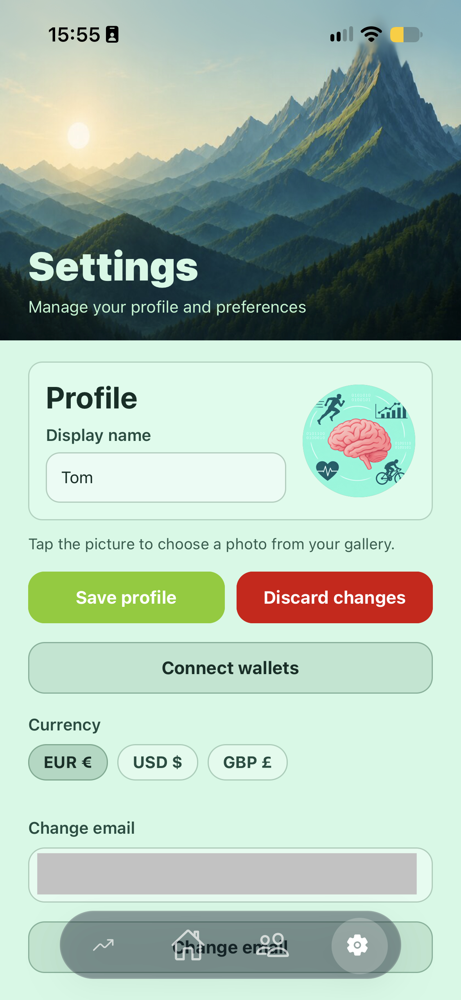

## Master's research

For my Master's research, I created a pipeline to automize cell quantification per brain area. [Have a look at the code](https://github.com/tomklumperman/Master-thesis)

  
  

## Sayver

I wanted to create an easy way to save money together with other people. This ended up in a an app to have an overview of all your finances. A main feature is to save for goals together with others. [Have a look at the code](https://github.com/tomklumperman/Sayver)

  
  
  
  

- 🔭 I’m currently working on a review / meta-analyses article about VO2max

- 📫 You can reach me via email: tomklumperman@gmail.com

